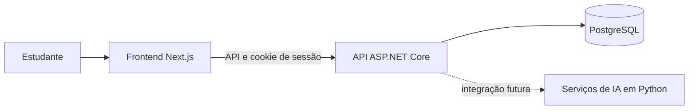

# AIStudy Lab

**Uma plataforma para organizar estudos, acompanhar o progresso e, futuramente, aprender com apoio de Inteligência Artificial.**

O AIStudy Lab está em desenvolvimento. Hoje, o núcleo do produto permite que cada pessoa organize disciplinas e assuntos, registre sessões de estudo, defina metas, acompanhe revisões e consulte seu desempenho. A aplicação web e a API já trabalham com PostgreSQL e contas autenticadas.

A biblioteca de documentos, o tutor de IA e os recursos de RAG fazem parte dos próximos passos; ainda não estão implementados. O projeto também serve como laboratório para explorar essas tecnologias de forma incremental.

> 🚧 **Status:** aplicação funcional em desenvolvimento. Consulte o [acompanhamento da implementação](./docs/implementation-status.md) para ver o que está pronto e o que falta.

## O que já funciona

- Cadastro, login e logout com sessão em cookie `HttpOnly`.
- Perfil do usuário e preferências.
- Cadastro e gerenciamento de disciplinas e assuntos.
- Registro de sessões de estudo, incluindo tempo e questões.
- Metas e revisões.
- Dashboard, histórico e estatísticas com dados da conta.
- Autorização por sessão: os endpoints de estudo identificam o usuário autenticado, sem confiar em um `usuarioId` enviado pelo navegador.

## O que está planejado

- Biblioteca e upload de materiais, com armazenamento e processamento de documentos.
- Tutor de IA e histórico de conversas.
- RAG, embeddings, busca vetorial e respostas com fontes.
- Flashcards, simulados e outras ferramentas de aprendizagem, ainda sujeitos à definição de escopo.

Esses itens são objetivos do produto, não funcionalidades disponíveis na versão atual.

## Tecnologias e arquitetura

| Componente | Tecnologia | Situação |
|---|---|---|
| Aplicação web | Next.js, React, TypeScript, Tailwind CSS | Implementada |
| API e regras de negócio | C#, ASP.NET Core e .NET 10 | Implementadas |
| Persistência | PostgreSQL e Entity Framework Core | Implementados |
| Testes do backend | xUnit e testes de integração da API | Implementados |
| Serviços de IA | Python | Planejados; ainda sem serviço integrado |
| Modelo de IA e busca vetorial | A definir | Planejados |

O backend está separado em API, aplicação, domínio e infraestrutura. O fluxo atualmente implementado é:



## Estrutura do repositório

```text
.
├── backend/
│   ├── AIStudyLab.Api/             # API ASP.NET Core e endpoints
│   ├── AIStudyLab.Application/     # Contratos e serviços da aplicação
│   ├── AIStudyLab.Domain/          # Entidades e regras de domínio
│   ├── AIStudyLab.Infrastructure/  # EF Core, PostgreSQL e migrations
│   └── tests/                      # Testes de domínio e integração
├── frontend/                       # Aplicação Next.js
├── python/                         # Espaço documentado para futuros serviços de IA
├── infra/                          # Documentação de infraestrutura planejada
└── docs/                           # Documentação técnica e funcional
```

## Executar localmente

### Pré-requisitos

- Node.js e npm.
- .NET SDK 10.
- PostgreSQL em execução e um banco criado para o projeto.

Python, Ollama e Qdrant **não são necessários** para executar as funcionalidades atuais.

### 1. Instalar dependências do frontend

Na raiz do repositório:

```powershell
npm install
```

### 2. Configurar e iniciar a API

Em um terminal PowerShell:

```powershell
cd backend
dotnet tool restore

$env:ConnectionStrings__DefaultConnection = "Host=localhost;Port=5432;Database=aistudylab;Username=postgres;Password=SUA_SENHA"

dotnet ef database update --project .\AIStudyLab.Infrastructure --startup-project .\AIStudyLab.Api
dotnet run --project .\AIStudyLab.Api --urls http://localhost:5259
```

Use uma senha local apropriada no lugar de `SUA_SENHA`. A connection string não deve ser adicionada a arquivos versionados. O endpoint de saúde fica em `http://localhost:5259/health`; em `Development`, a documentação OpenAPI fica em `http://localhost:5259/openapi/v1.json`.

### 3. Iniciar o frontend

Em outro terminal, na raiz do repositório:

```powershell
npm run dev
```

Abra `http://localhost:3000`. Por padrão, o frontend usa a API na porta `5259`, preservando o hostname usado no navegador. Se a API estiver em outro endereço, defina `NEXT_PUBLIC_API_BASE_URL` antes de iniciar o Next.js.

Crie uma conta pela tela de login/cadastro para começar a usar as páginas autenticadas. O arquivo [AIStudyLab.Api.http](./backend/AIStudyLab.Api/AIStudyLab.Api.http) contém exemplos de requisições para a API.

> As instruções detalhadas de migrations, autenticação e testes também estão em [backend/README.md](./backend/README.md).

## Testes e build

Na raiz, valide o frontend:

```powershell
npm run build
npm run lint
```

Para compilar e testar o backend:

```powershell
dotnet build .\backend\AIStudyLab.slnx
dotnet test .\backend\AIStudyLab.slnx
```

## Segurança e implantação

- As páginas e rotas de estudo exigem uma sessão autenticada; os dados são consultados no escopo do usuário da sessão.
- O cookie de sessão é `HttpOnly` e `SameSite=Strict`; fora de `Development`, é enviado somente por HTTPS.
- As operações de escrita validam origem e cabeçalho anti-CSRF. A API exige origens CORS configuradas fora de `Development`.
- Login e cadastro têm limitação de requisições por endereço IP.
- A connection string deve ser fornecida por configuração segura do ambiente, nunca commitada.

Antes de publicar, configure HTTPS e as origens confiáveis do frontend (`Cors__AllowedOrigins__0`, `Cors__AllowedOrigins__1` etc.). Veja [backend/README.md](./backend/README.md) para detalhes operacionais.

## Documentação

- [Status e próximos passos](./docs/implementation-status.md)
- [Arquitetura](./docs/architecture.md)
- [Modelo de dados](./docs/database.md)
- [API](./docs/api.md)
- [Regras de negócio](./docs/business-rules.md)
- [Experiência do usuário e telas](./docs/09_UI_UX/README.md)
- [Instruções do backend](./backend/README.md)

---

O AIStudy Lab é desenvolvido de forma incremental, unindo organização da aprendizagem, engenharia de software e experimentação responsável com Inteligência Artificial.
