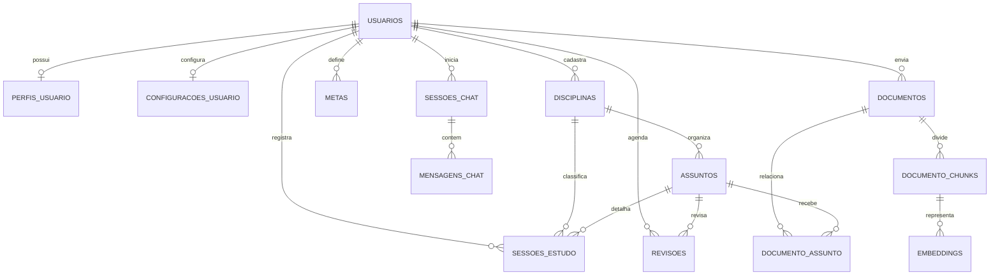

# Modelo de Dados do AIStudy Lab

Este documento descreve o modelo de dados planejado para o AIStudy Lab. Ele serve como referência para a implementação do backend em C# e deve evoluir junto com as regras de negócio do produto.

## Decisões técnicas

- **Banco relacional:** PostgreSQL.
- **Mapeamento e evolução do schema:** Entity Framework Core (EF Core), usando migrations versionadas no backend.
- **Responsabilidade:** o backend .NET será o único responsável por criar e alterar as tabelas. Não manteremos um schema paralelo do mesmo domínio no Prisma do frontend.
- **Estado atual:** o núcleo de acompanhamento de estudos, conta, perfil e preferências é acessado pelo frontend através da API .NET. A remoção do protótipo Prisma/SQLite legado deve ser confirmada após validar que não há consumidores ativos.
- **Conexão:** a connection string será configurada posteriormente, por configuração segura do ambiente. Não deve ser gravada neste documento nem commitada no repositório.
- **Convenções propostas:** entidades e propriedades em PascalCase no C#; tabelas e colunas em `snake_case` no PostgreSQL; chaves primárias chamadas `id` e chaves estrangeiras com o sufixo `_id`. O EF Core configurará os mapeamentos explicitamente.
- **Datas:** usar `timestamp with time zone` para instantes e `date` para datas sem horário. Persistir instantes em UTC.

As migrations devem ser a fonte de verdade do schema. Alterações estruturais devem ser feitas no modelo/configuração do EF Core e registradas em migration; não devem ser aplicadas manualmente em ambientes compartilhados.

## Escopo por etapa

### Núcleo do MVP

- Conta, perfil e preferências do usuário.
- Disciplinas, assuntos e sessões de estudo.
- Metas e revisões.
- Biblioteca de documentos e associação dos documentos aos assuntos.
- Conversas e mensagens do tutor, quando o fluxo de chat for implementado.

### Evolução para IA e operação

- Extração de texto e divisão dos documentos em trechos.
- Embeddings e recuperação de fontes para RAG.
- Catálogo de modelos e registro de execuções de IA.
- Notificações, auditoria e registros de atividade.
- Planejamento de estudo, caso o produto passe a oferecer planos recorrentes.

As entidades desta segunda etapa não precisam ser criadas antes de existir um fluxo que as utilize. A extensão vetorial `pgvector` também será avaliada quando a busca semântica entrar no escopo.

## Mapa de relacionamentos

O diagrama inclui entidades futuras de documentos/IA para mostrar a direção planejada; a seção seguinte identifica o que pertence ao núcleo e o que pode ser adicionado depois.

## Entidades do núcleo

### `usuarios`

Conta e identidade de autenticação.

- `id` (PK)
- `nome`
- `email` (único, normalizado para comparação)
- `senha_hash` (somente hash seguro; nunca armazenar senha em texto puro)
- `avatar_url` (opcional)
- `status`
- `criado_em`, `atualizado_em`, `ultimo_login_em` (opcional)

### `perfis_usuario`

Informações complementares e opcionais, separadas dos dados de autenticação.

- `id` (PK)
- `usuario_id` (FK única para `usuarios`)
- `objetivo`, `nivel`, `cidade`, `instituicao`, `bio` (opcionais)
- `data_nascimento` (opcional)
- `criado_em`, `atualizado_em`

Cardinalidade: usuário 1 — 0..1 perfil.

### `configuracoes_usuario`

Preferências da interface e da rotina de estudos.

- `id` (PK)
- `usuario_id` (FK única para `usuarios`)
- `tema`, `idioma`
- `notificacoes_ativadas`
- `objetivo_diario_minutos`
- `disciplina_foco_id` (FK opcional para `disciplinas`)
- `criado_em`, `atualizado_em`

Cardinalidade: usuário 1 — 0..1 configuração. A configuração pode ser criada junto com a conta ou sob demanda.

### `disciplinas`

- `id` (PK), `usuario_id` (FK)
- `nome`, `cor`, `icone`
- `ativa`
- `criado_em`, `atualizado_em`

Cada usuário possui suas próprias disciplinas. Nome duplicado pode ser permitido ou impedido por uma restrição única por usuário, conforme a regra de produto a ser fechada.

### `assuntos`

- `id` (PK), `disciplina_id` (FK)
- `nome`, `descricao` (opcional)
- `dificuldade` (opcional), `ordem`
- `criado_em`, `atualizado_em`

Cardinalidade: disciplina 1 — N assuntos. O usuário dono é determinado pela disciplina; isso evita duplicar `usuario_id` e reduz o risco de inconsistência entre dono e disciplina.

### `sessoes_estudo`

Registro de uma sessão concluída ou realizada pelo usuário.

- `id` (PK), `usuario_id` (FK), `disciplina_id` (FK), `assunto_id` (FK opcional)
- `data` (`date`, dia em que a sessão ocorreu)
- `tempo_estudado_minutos` (duração registrada diretamente; por enquanto, não persistir início e fim)
- `questoes`, `acertos`, `erros`
- `banca` e `observacoes` (opcionais)
- `criado_em`, `atualizado_em`

Uma sessão pertence a um usuário e é classificada por disciplina; o assunto pode ser opcional para sessões gerais. O backend deve validar que a disciplina/assunto selecionado pertence ao mesmo usuário e que o assunto pertence à disciplina selecionada.

### `metas`

- `id` (PK), `usuario_id` (FK)
- `tipo`, `nome`, `unidade`
- `quantidade`
- `data_inicio`, `data_fim`
- `ativa` ou `status`
- `criado_em`, `atualizado_em`

O progresso deve ser calculado a partir dos registros correspondentes sempre que possível, em vez de manter um valor que possa divergir dos dados de estudo. Se for necessário persistir progresso para desempenho, deve haver uma estratégia explícita de atualização.

### `revisoes`

- `id` (PK), `usuario_id` (FK), `assunto_id` (FK)
- `data_agendada`
- `status` (por exemplo, pendente, concluída ou cancelada)
- `data_conclusao` e `observacoes` (opcionais)
- `criado_em`, `atualizado_em`

Cada revisão pertence a um usuário e a um assunto. A consistência entre o dono da revisão e o dono do assunto deve ser validada no backend.

## Escopo já implementado no backend

A primeira estrutura EF Core contempla `usuarios`, `perfis_usuario`, `configuracoes_usuario`, `disciplinas`, `assuntos`, `sessoes_estudo`, `metas` e `revisoes`. A autenticação usa cookie HttpOnly e as operações autenticadas obtêm o usuário da identidade da sessão; o perfil permite consulta e atualização dos campos definidos nesta documentação. Os arquivos binários, conversas, mensagens e dados de RAG continuam planejados para etapas futuras.

O backend usa GUIDs como chaves primárias. As entidades de sessão armazenam a data (`date`) e a duração em minutos, sem início/fim, evitando duas fontes de verdade para o tempo estudado. As constraints também protegem as regras de tempo não negativo e `questoes = acertos + erros`.

## Biblioteca e IA

Estas entidades podem ser adicionadas em etapas, sem bloquear o núcleo do MVP.

### `documentos`

- `id` (PK), `usuario_id` (FK)
- `titulo`, `descricao` (opcional), `tipo`
- `caminho_arquivo` ou chave do objeto no armazenamento, `mime_type`, `tamanho_bytes`
- `status_processamento`
- `criado_em`, `atualizado_em`

O arquivo binário deve ficar em armazenamento de arquivos/objetos; o banco guarda seus metadados e a referência ao arquivo.

### `documento_assunto`

Tabela de associação N:N entre `documentos` e `assuntos`, com chave primária composta (`documento_id`, `assunto_id`). Permite que um documento auxilie o estudo de mais de um assunto.

### `sessoes_chat` e `mensagens_chat`

- `sessoes_chat`: `id`, `usuario_id` (FK), `titulo`, `status`, `criado_em`, `atualizado_em`.
- `mensagens_chat`: `id`, `sessao_chat_id` (FK), `remetente`, `tipo`, `conteudo`, `criado_em`.

Uma conversa pertence a um usuário e contém mensagens ordenadas cronologicamente. Metadados de tokens, custos e modelo usado podem ser acrescentados quando houver integração de IA que os forneça.

### `documento_chunks` e `embeddings`

- `documento_chunks`: `id`, `documento_id` (FK), `ordem`, `texto`, metadados de extração e `criado_em`.
- `embeddings`: `id`, `documento_chunk_id` (FK), `modelo`, vetor e `criado_em`.

O tipo e a dimensão do vetor dependem do modelo de embeddings escolhido. A implantação deve definir como a extensão `pgvector` será habilitada e como embeddings antigos serão tratados ao trocar de modelo.

## Regras de integridade e exclusão

- Quantidades de tempo e questões não podem ser negativas.
- `acertos + erros` deve corresponder a `questoes`; acertos não podem exceder questões. Validar também no backend, pois a restrição `CHECK` do PostgreSQL não pode comparar colunas de forma tão expressiva em todas as combinações semânticas.
- Uma disciplina não deve ser excluída enquanto houver sessões dependentes. Para preservar histórico, preferir desativar (`ativa = false`) a excluir.
- Exclusões em cascata devem ser definidas explicitamente por relacionamento. Não usar cascade indiscriminadamente em entidades que representem histórico.
- Todas as consultas e comandos sobre dados de estudo devem ser limitados ao usuário autenticado. IDs recebidos do cliente não são prova de propriedade.
- Usar restrições e índices para proteger e acelerar o domínio: unicidade de e-mail; índices em FKs; índices por usuário e data nas sessões, revisões, metas e documentos.

## Aplicação no Entity Framework Core

No backend .NET:

1. As entidades de domínio e suas configurações EF Core descrevem tabelas, colunas, relacionamentos, índices e restrições.
2. O `DbContext` fica na camada de infraestrutura, junto do acesso a dados.
3. Usar o provider PostgreSQL do EF Core (Npgsql).
4. Gerar migrations versionadas a partir das alterações do modelo e aplicá-las nos ambientes de forma controlada.
5. Manter a connection string fora do código e do controle de versão; ela será adicionada quando o banco/ambiente estiver pronto.
6. O frontend Next.js acessará dados através da API .NET, não diretamente via Prisma ou conexão direta ao banco.

## Endpoints iniciais

As operações do frontend ficam na API .NET:

- `POST /api/auth/register`, `POST /api/auth/login`, `POST /api/auth/logout` e `GET /api/auth/me`.
- `GET` e `PUT /api/me/perfil`.
- Endpoints autenticados em `/api/me` para disciplinas, assuntos, sessões, metas, revisões, dashboard e configurações.

As rotas de estudo e perfil exigem uma sessão autenticada. O identificador do usuário vem da claim protegida no cookie, nunca de um parâmetro de rota. O cookie é HttpOnly e SameSite Strict; operações de escrita também validam origem e cabeçalho anti-CSRF. Configurar HTTPS e as origens CORS corretas é obrigatório antes da publicação.

## Pontos a decidir antes da implementação

- Se assunto será obrigatório em todas as sessões (atualmente é opcional para permitir sessões gerais).
- Política de exclusão/anonimização de conta e retenção de histórico.
- Onde armazenar arquivos e limites de tamanho/tipo.
- Provedor de IA, formato de embeddings e dimensão vetorial.
- Se haverá catálogo global de disciplinas/assuntos ou somente cadastros privados por usuário.